# Milestone 0 in Unreal: status against the gates

Milestone 0 of the [development plan](DEVELOPMENT_PLAN.md) (with 0b and 0c), carried out on
the Unreal 5.8 port, judged against the plan and its moodboard. Evidence is reproducible:
`-shots` and `-trial` runs (see the README), and the automation tests. Reference machine:
NVIDIA GeForce RTX 5080, AMD Ryzen 7 9800X3D (16 logical cores), 62 GB RAM, Development build,
1600 x 900 window.

## Step by step

1. **Scale through ground-level compositions.** The 1000 km home planet carries the scale
   study's stand-ins, kitbashed after the moodboard: a 1.8 m person, a six-wheeled rover, a
   34 m tracked drill crawler, a 52 m walking factory on six legs, and a brutalist
   megastructure 1.6 km long and 340 m tall. The same compositions are produced at eye
   height, 150 m, 2 km and 30 km.
2. **Bounded residency.** The level-of-detail octree around the camera bounds what is
   rendered. Edits are sparse copy-on-write bricks (`FTerrainEdits`), allocated only where
   something was dug; the procedural terrain is regenerated on demand. Render components are
   pooled, and the node-surface cache is bounded.
3. **Terrain forms and geology at several scales.** Basins and plains (70 km), escarpments
   (25 km), mountain ranges (14 km ridges in 45 km masks) cut by valleys (passes, and 60 m
   canyons across the plain), mesas and spire fields as landmarks, hills, clustered rock
   outcrops, ground detail down to 4.5 m roughness. Every layer has rigorous interval bounds,
   so the culling stays exact (`Stellar.Terrain.HeightBounds`). Geology: regolith, banded
   sandstone with iron sheets, basalt with copper pockets and deeper quartz, each with
   hardness; the strata show in every cut. Built ground is recorded as fill.
4. **Atmospheric distance and scale cues.** A sky atmosphere concentric with the planet with
   dustier air for aerial perspective, volumetric clouds 6-11 km up, a warm accretion light
   that can be moved (`[` / `]`), exposure kept to a daylight band, a helmet lamp for caves.
   Steep ground shows strata; stones, rocks and boulders are scattered over the near ground.
   The terrain material adds detail noise at three scales, read from wrapped planet
   coordinates so it stays precise anywhere on the planet.
5. **Coordinates at scale.** Unreal's large world coordinates plus node-local meshes evaluated
   from double-precision node origins. The plan's open decision, a double-precision engine
   build versus rebasing, needs neither. The density from a node origin plus a float offset
   matches doubles within 0.3 mm anywhere on the planet (`Stellar.Terrain.PrecisionAt1000km`),
   and the trial measured 0.000 mm at every stop out to the far side. Motion, sampling, tracing
   and edits all run in doubles.
6. **Traversal and editable persistence.** The trial below.

## Visual gate

Taken by `-shots`. The pictures are judged in a fresh review, not here, but they show what the
gate asks for.

| | |
|---|---|
| 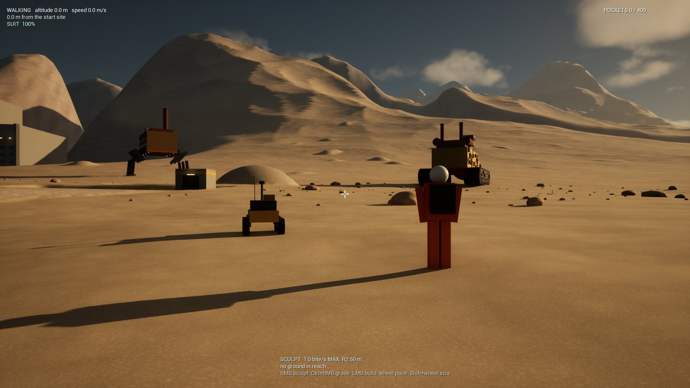 Eye height: the person and rover small in the foreground, the crawler at its site, scattered rocks, ridges 15 km away under clouds. | 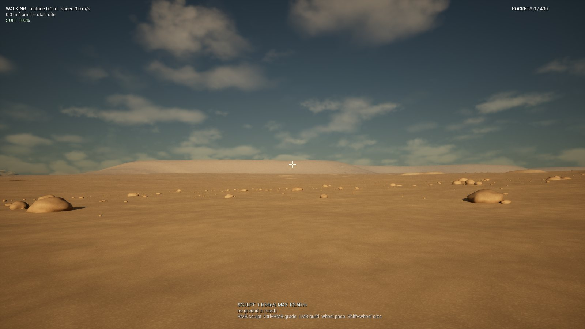 A mesa 37 km away on the horizon, softened by aerial perspective. |
| 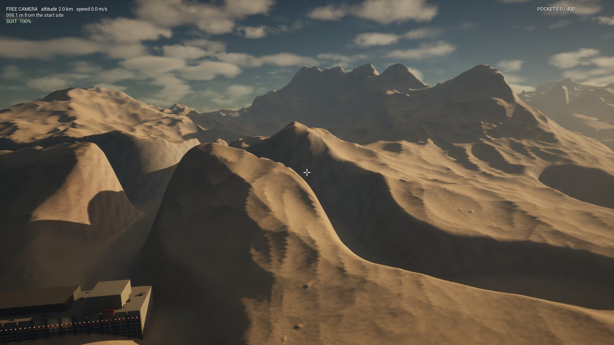 2 km up: new terrain keeps appearing rather than the whole world; the megastructure bottom left. | 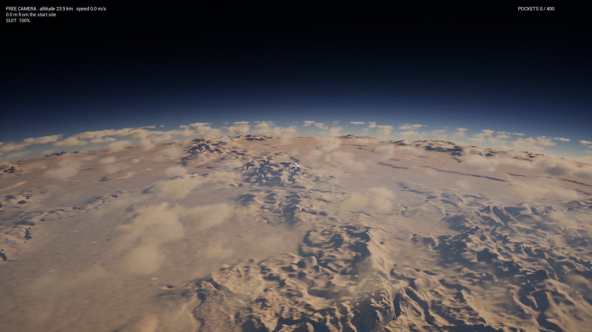 30 km up: open country on a gently curved horizon. |
| 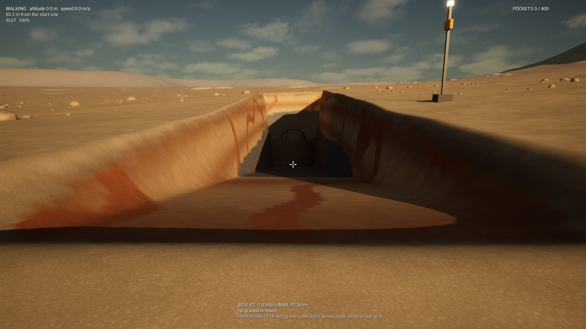 The test site's ramp: banded sandstone with iron in its walls, the tunnel at the foot. | 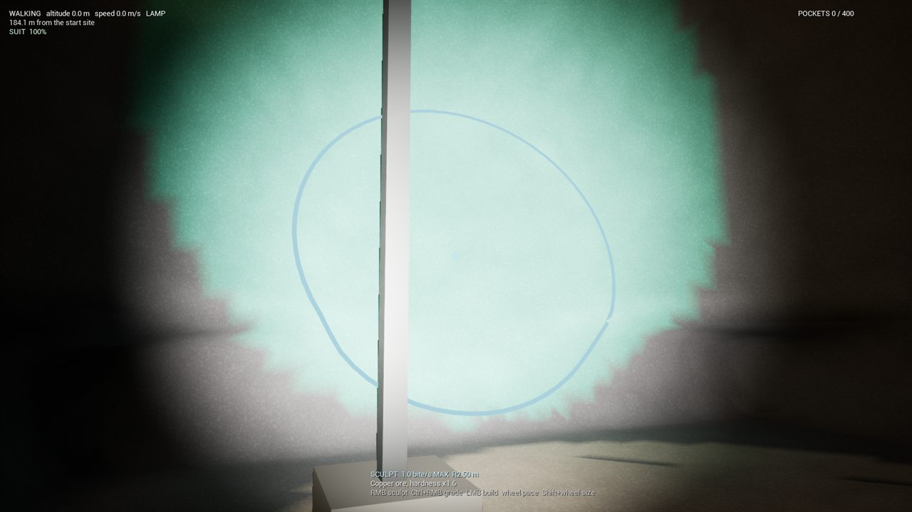 The cavern by lamplight: copper in basalt. |

### Art pass against the moodboard (2026-11-02)

The board's export was reviewed image by image ([MOODBOARD.md](MOODBOARD.md)), and the build was
moved toward it. The tour now ends with four of the board's machine compositions:

| | |
|---|---|
| 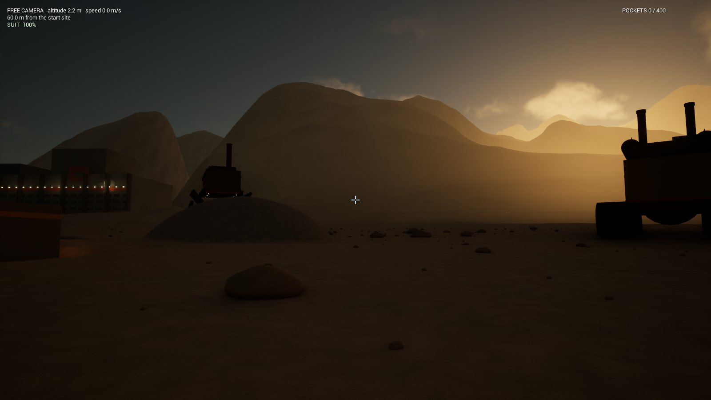 Golden hour: the crawler, the walker and the megastructure in silhouette against the low sun, through dusty air. | 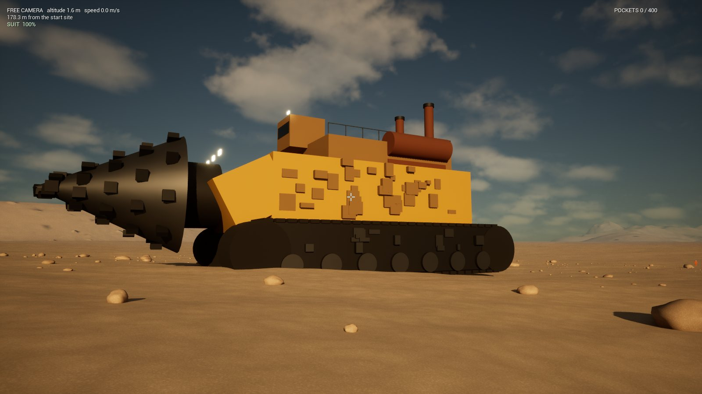 From eye height beside the drill crawler: tracks, the toothed drill head, stacks and work lights. |
| 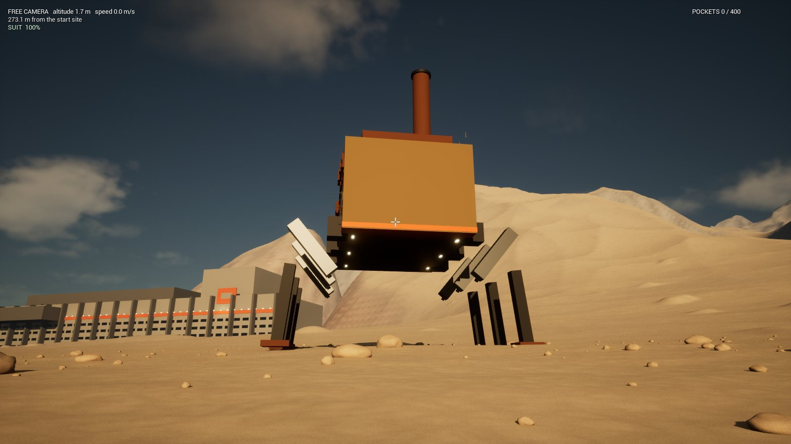 The walking factory, a mobile factory on six legs. | 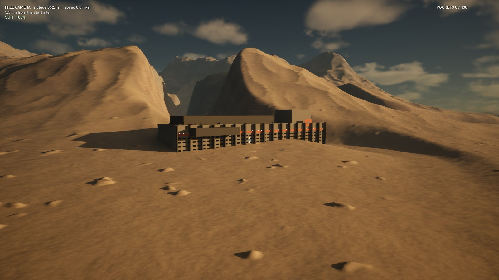 The megastructure from 2.8 km, against the ranges. |

What changed:
- **Air and light.** Dustier, warmer air for deeper aerial perspective. The sun can be moved
  (`[` / `]`, with Shift around the horizon), and the tour sets it per composition.
- **Ground.** Stones, rocks and boulders are scattered within 150 m of the camera. They are
  seeded by position, kept off steep and edited ground, and cleared around the site and the
  machines. Cliffs, mesas and escarpments show strata. The ground's "cracked mud" cells were
  a precision artifact: the material read planet positions from the procedural mesh's UVs,
  which are half floats. It now reads each node's origin from custom primitive data, plus
  the local position.
- **Machines.** The box stand-ins are now kitbashed from instanced parts (`Game/StandIns`):
  tracks, legs, hulls, stacks, railings, windows, lamps and greebles, in industrial paint with
  one accent colour. The megastructure stands on the flattest footprint near its place, so its
  base is not buried in a dune.
- **Tried and dropped.** Rock micro-relief bumped from screen-space derivatives of the
  material's noise rendered as pixel blocks at every amplitude tried. It needs an authored
  detail-normal texture.

Still for later art passes: smoke and dust, authored rock materials and detail normals, wear
and decals, vegetation for the board's hopeful register, and the cavern lighting palette.
Judge the "realistic sci-fi" register from these as a stand-in stage, not a finish.

## Technical gate

`-trial` fast-travels to stops along a great circle out to the far side, digs at each, revisits,
then saves, clears and reloads ([full report](milestone0/trial_report.md)):

| stop | distance | streaming | 6 bites to meshed | nodes | triangles | p50 / p95 / p99 frame |
|---|---|---|---|---|---|---|
| start site | 0 km | 0.19 s | 0.13 s | 1,374 | 2.24 M | 3.1 / 4.4 / 7.4 ms |
| 25 km | 25 km | 3.19 s | 0.14 s | 2,131 | 2.60 M | 2.9 / 4.1 / 7.8 ms |
| 120 km | 120 km | 2.07 s | 0.11 s | 1,491 | 2.52 M | 2.8 / 3.9 / 7.3 ms |
| 400 km | 400 km | 3.61 s | 0.18 s | 2,604 | 3.14 M | 3.1 / 4.0 / 9.6 ms |
| far side | 3,141 km | 4.85 s | 0.19 s | 3,338 | 3.28 M | 2.7 / 3.8 / 9.8 ms |

These are from the final build of the art pass (rocks and kitbashed stand-ins included). An
earlier run on the same build measured about 2 ms more per frame at every stop, the far side
included, where none of the new scenery is drawn. A rerun gave the figures above, in line with
runs before the art pass, so the difference looks like load on the machine, not the build.

Startup, from process start to the first complete cut, is 14.5 s; that includes engine start and
the test site's 3 s of authoring. Every check passes:
- footing within 4 mm;
- digging removes ground at every stop;
- the cuts are there after leaving their render range and returning;
- every cut survives save, clear and load;
- structures and water survive too (the save is 10 MB, compressed).

The far side is in night: the trial keeps the light where the start site has it.

**Budget.** The trial's residency budget per view is 4,000 terrain nodes and 4.5 M triangles. A
first guess of 2,500 nodes, set before any measurement, was exceeded on rugged ground (3,338
nodes at the far side) while frames stayed at 4.2 ms p95, so the budget was raised from the
measurements. Resident memory levels off as the same ground is revisited (per stop, five laps):
the second lap adds 84-589 MB as pools and caches reach their working size, then at most
+114, +63 and +30 MB. The last lap is within +30 MB at every stop.

## 0b: the industrial test site

`FTestSitePlan` lays out a repeatable scenario beside the start site, against the ground actually
there (`Stellar.Game.TestSite` checks it on the real site):

- a graded 70 x 44 m yard (room for a road loop);
- a 70 m ramp at about 11 degrees down to a pit;
- a tunnel into a chamber under at least 2 m of rock;
- iron in sandstone in the ramp's wall and copper in basalt in the chamber, each with a beacon;
- a depot.

| | |
|---|---|
| 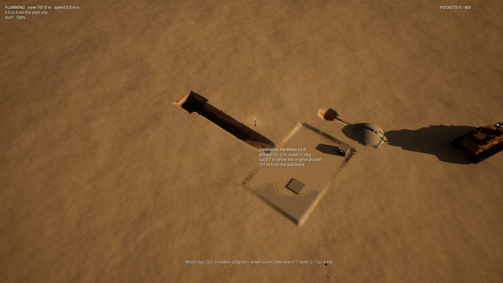 The planning view. Cursor inspect reads rock, deposit, height, slope, depth of the cut and distance. Two pads were placed through the same checks the player's placement uses. | 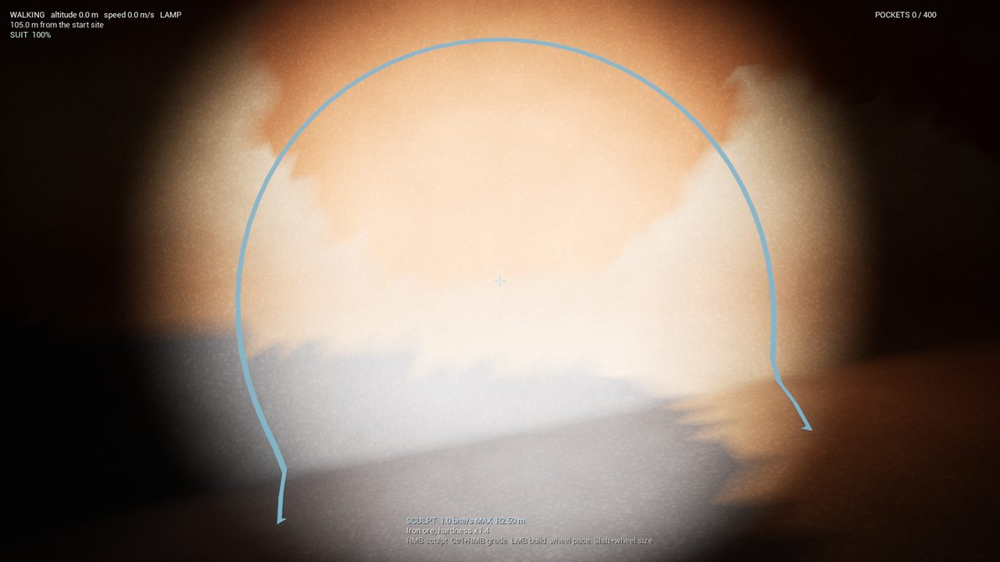 Iron in the sandstone wall, as the brush's readout names it. |

The planning view (O) pans, zooms and turns over the ground, inspects what is under the
cursor, selects and places, and returns to the astronaut. The simulation keeps running: the
astronaut stands, falls and is dug under while you plan. Placement (T) works from both views,
with a translucent preview and a reason when blocked: uneven ground ("grade it first"),
overlap, or out of reach. Underground it finds the cave floor, not the roof. Structures carry a
stable ID, the ID of the body they stand on, and a planet-frame transform, and they are saved.
Grading (Ctrl+RMB) levels to the height where it started.

Recorded in the same scenario: test site authored in 3.0 s (15 edits, 1,525 bricks, 29.8 MB
of edits before compression); six bites dug and remeshed in 0.12 s; p95 frame time 4.3 ms
at the site.

## 0c: the fluid spike

The decision and its measurements are in [FLUID_SPIKE.md](FLUID_SPIKE.md): a cellular volume of
fluid on the terrain's cells, chosen over a heightfield. In the test site:
- the spring fills the channel and the basin;
- breaching the sealed pocket from the ramp drains it down to the pit and tunnel, with volume
  conserved;
- settled regions cost nothing.

The terrain's save format carries a channel mask per brick, so further per-lattice data needs
no migration.

| | |
|---|---|
| 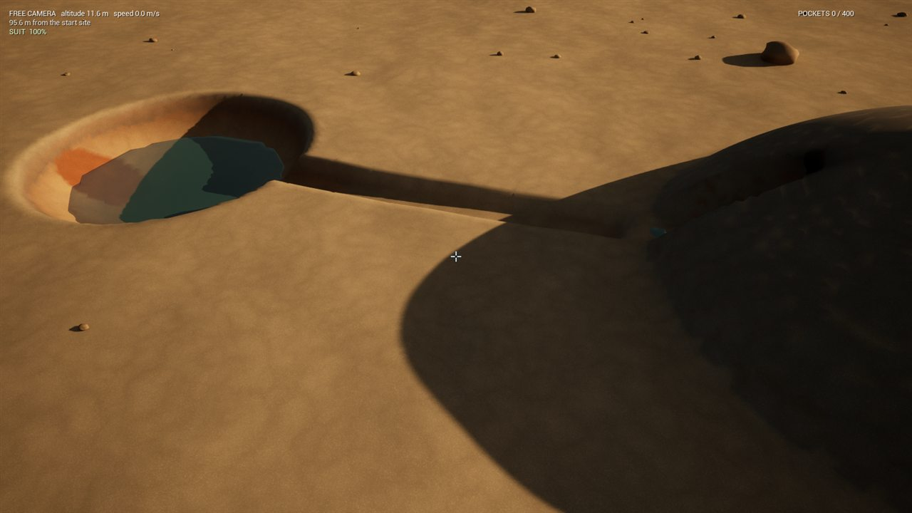 The spring's water collected in the dug basin. | 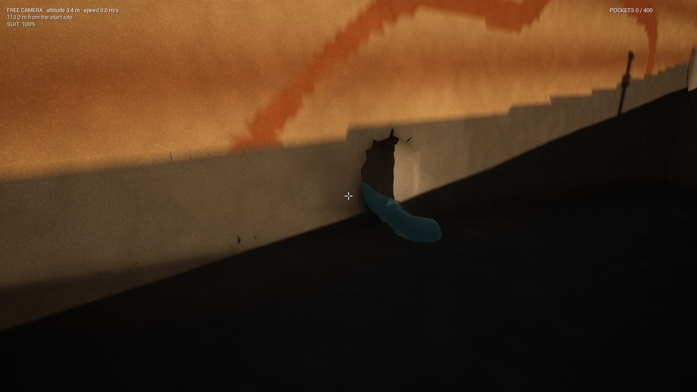 The pocket breached from the ramp, draining. |

## Still open

- **Art direction.** An authored rock material set with detail normals, effects (smoke, dust),
  wear and decals, a time-of-day cycle, and a fresh review of the compositions against the
  moodboard.
- **Planning view features** wanted by later milestones: overlays, area selection, the
  underground/section view (milestone 6).
- **Measurements on target hardware.** The plan leaves the target hardware open; these numbers
  are from one high-end machine.
- **Fluid fidelity** beyond the spike: pressure, regions created where the player digs into
  groundwater, and offscreen settling (milestones 6-7).
